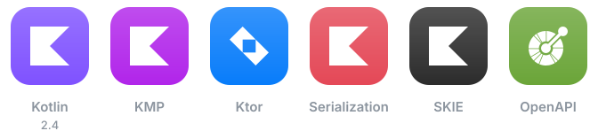
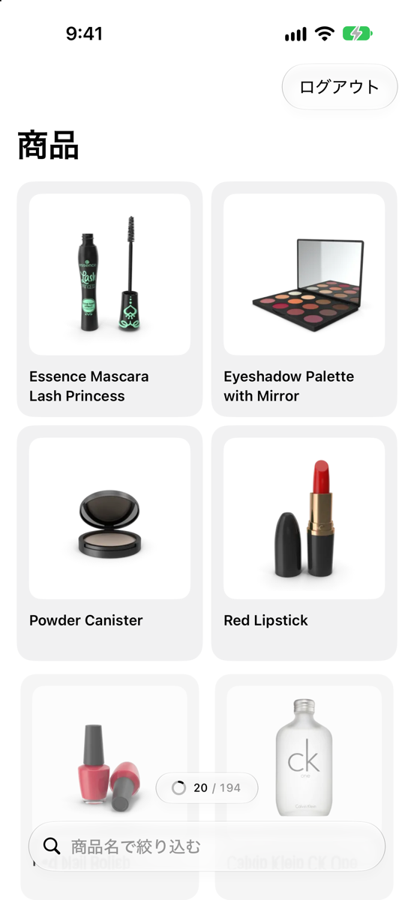
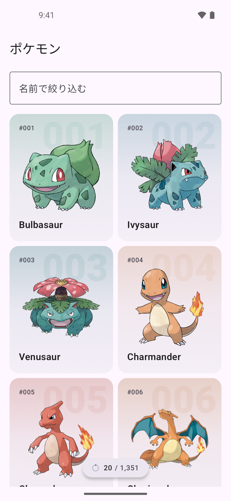
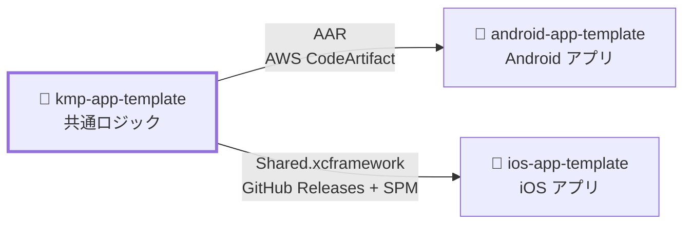
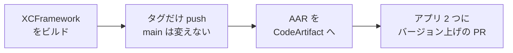

# 🧩 kmp-app-template

iOS と Android で共有するロジックを Kotlin Multiplatform で書いたライブラリ



## ✨ 機能

| 🍎 iOS（SwiftUI） | 🤖 Android（Jetpack Compose） |
| --- | --- |
| <picture><source media="(prefers-color-scheme: dark)" srcset="docs/images/ios-list-dark.png"></picture> | <picture><source media="(prefers-color-scheme: dark)" srcset="docs/images/android-list-dark.png"></picture> |

| 機能 | 内容 |
| --- | --- |
| ログイン | DummyJSON へのログインと、トークンの保存（Keychain / Keystore）・更新 |
| 商品一覧 | 価格・ブランドを含む取得とページング |
| エラー | 通信の失敗を分類して返す |

## 🗺️ 全体像



[🍎 ios-app-template](https://github.com/yossibank/ios-app-template) ・ [🤖 android-app-template](https://github.com/yossibank/android-app-template)

## 💻 実行環境

| 項目 | 内容 |
| --- | --- |
| 対応 OS | iOS、Android 7+（minSdk 24） |
| 言語 | Kotlin 2.4 |
| ビルド | Gradle 9.8.2 |
| 主な技術 | Kotlin Multiplatform、Ktor、kotlinx.serialization、SKIE、OpenAPI |

[手順とコマンド](docs/development.md)

## 🚀 入れ方

```sh
# テンプレートから作ったとき：GitHub のオーナーとパッケージの接頭辞を置き換える
# 3 つのリポジトリそれぞれで実行する
scripts/rename.sh <GitHub のオーナー> <パッケージの接頭辞>    # 例: scripts/rename.sh acme com.acme
```

## 📚 文書

| 文書 | 内容 |
| --- | --- |
| [docs/development.md](docs/development.md) | コマンドと、リリースの手元での実行 |
| [docs/integration.md](docs/integration.md) | 既存のアプリに組み込む手順 |

## 📦 リリース



| 実行する所 | 方法 |
| --- | --- |
| GitHub Actions | Release ワークフローにバージョン（semver）を渡す |
| 手元 | AWS にログインして `./release.sh <version>` |
